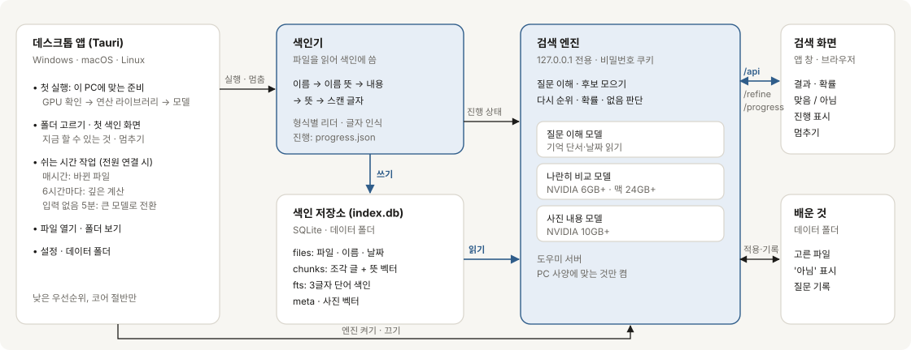
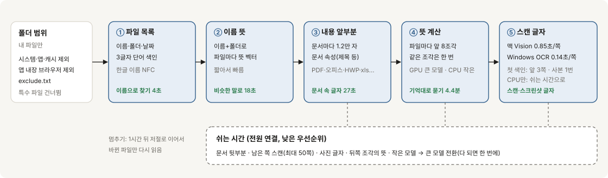
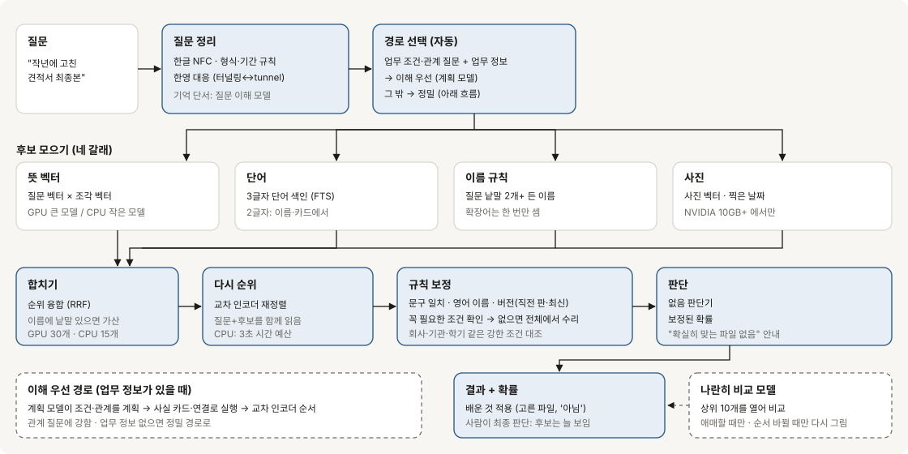

# findr

기억나는 대로 물으면 내 PC에서 파일을 찾아 줍니다. "지난달 거래처에서 받은 견적서", "최종본 말고 그 직전 판"처럼 물으면, 맞을 가능성이 높은 파일을 확률과 함께 보여 줍니다. 모든 처리는 내 컴퓨터 안에서 이뤄집니다. 계정도, 업로드도, 클라우드도 없습니다.

[내려받기](https://github.com/quantumaikr/findr/releases/latest) · [English](README.md) · [동작 방식](#동작-방식) · [성능](#성능) · [현장에서 배운 것](docs/LESSONS.md)

```
> 작년 여름 휴가 때 찍은 바다 사진
  1  92%  IMG_5082.jpg      2025-08-12
  2  71%  IMG_5090.jpg      2025-08-13
  3  38%  KakaoTalk_...jpg  2025-08-20

> 2019년 세금 환급 영수증
  확실히 맞는 파일을 찾지 못했습니다. 가까운 후보를 확률과 함께 보여 드립니다.
```

findr는 한국의 사무실 PC에 실제로 쌓이는 파일을 먼저 생각하고 만들었습니다. HWP, 스캔한 서류, 맥에서 만든 한글 이름 폴더 같은 것들입니다. 영어 이름과 내용도 함께 읽습니다. 지금은 0.2 버전이며, Windows·macOS·Linux 설치 파일로 배포합니다.

## 왜 만들었나

파일을 찾을 때 이름이 기억나는 경우는 많지 않습니다. 대신 누가 보냈는지, 대략 언제인지, 무엇 때문이었는지, 몇 번째 판이었는지를 떠올립니다. PC의 검색 기능은 이름과 단어가 맞아야 찾기 때문에, 기억이 흐릿할수록 놓칩니다. 클라우드 AI는 흐릿한 질문에도 답하지만, 파일을 PC 밖으로 보내야 합니다.

findr는 그 사이에 있습니다. 흐릿하고 말하듯 한 질문을 이해하면서, 모든 일을 파일이 있는 그 PC 안에서 합니다.

## 무엇이 다른가

**몇 초 만에 쓸 수 있고, 쓸수록 똑똑해집니다.** 첫 색인은 속도를 먼저 생각하고, 나머지는 PC를 쓰지 않는 시간에 채웁니다. GPU 없는 4코어 노트북에서 이름 검색은 4초, 이름의 뜻으로 찾기는 18초부터 됩니다. 문서 속 글자는 27초, 내용의 뜻으로 찾기는 4.4분부터입니다. 실제 PC에서 잰 정확도는 첫 색인 직후와 모든 내용을 읽은 뒤가 측정 오차 범위 안에서 같았습니다.

**사람이 말하는 대로 묻습니다.** 질문 속의 내용과 함께 다음을 읽습니다.
- 때: "작년 8월", "회의 전에"
- 사람: "김 부장이 보낸"
- 판: "최종본 말고 그 직전 판"
- 영어 파일 이름에 대응하는 한국어 낱말: '터널링'으로 `Tunneling_Design.pdf`를 찾음
- 형식과 문서 종류: "pdf로 된", "회의록"처럼 말하면 끝까지 조건으로 지킴
- 해: '작년', '재작년', '올해'. 그 해에 맞는 파일이 없으면 앞뒤 해로 넓혀 찾고 그렇다고 알림
- 같은 파일의 사본은 결과 한 자리로 묶음

**사무실 PC에 실제로 있는 파일을 읽습니다.**
- 문서: PDF, 워드·엑셀·파워포인트, HWP·HWPX
- 배포용 HWP: 한컴이 공개한 명세에 따라 풀어서 읽음
- 그 밖: 예전 .xls와 .ods, 한국어 코드 페이지의 RTF, 메일(.eml), 키노트·페이지스·넘버스, 아이폰 HEIC 사진
- 스캔과 스크린샷 속 글자: 운영체제에 들어 있는 글자 인식을 먼저 씀. 쪽당 Windows 0.14초, macOS 0.85초

**모르면 모른다고 합니다.** 후보마다 맞을 확률을 보여 줍니다. 질문의 조건을 모두 갖춘 파일이 없으면, 가장 가까운 파일을 답처럼 내놓지 않고 그렇다고 알립니다. 최종 선택은 사람이 하고, findr는 사람이 고른 파일과 '아님'으로 표시한 파일에서 배웁니다.

**구조부터 개인정보를 지킵니다.** 색인과 검색은 모두 PC 안에서 합니다. 검색 화면은 이 PC(127.0.0.1)에서만 열리고 비밀번호로 보호됩니다. 비밀번호나 키처럼 보이는 값은 색인하지 않고 가립니다.

**가진 PC에서 그대로 돌아갑니다.** NVIDIA GPU, Apple 칩, GPU 없는 노트북에 맞춰 구성이 달라집니다. GPU 없는 PC는 작은 모델로 시작하고, 아무도 PC를 쓰지 않는 동안 조금씩 큰 모델로 옮겨 갑니다.

## 성능

모든 수치는 findr를 조정하는 데 쓰지 않은 질문으로 쟀습니다. PC와 파일 구성에 따라 달라지므로, 어떻게 쟀는지도 함께 적습니다.

**정확도**

| 측정 조건 | 질문 | 1위 | 3위 안 |
|---|---|---|---|
| 개발 중 한 번도 보지 않은 가상 PC 6대, 활동 기록 없음 | 288 | 76% | 90% |
| 실제 개인 PC, 따로 떼어 둔 질문 | 45 | 84% | 89% |
| 같은 PC를 새로 색인: 빠른 첫 색인 직후 | 45 | 82% | 87% |
| 같은 PC를 새로 색인: 쉬는 시간 깊은 계산 뒤 | 45 | 82% | 89% |
| 사진과 문서가 섞인 PC, 사진 질문 (NVIDIA GPU) | 47 | 85% | — |
| 같은 실제 PC, GPU 없이 CPU 4코어, 첫날 | 45 | 56% | 62% |
| 같은 실제 PC, GPU 없이 CPU 4코어, 쉬는 시간에 큰 모델로 바꾼 뒤 | 45 | 78% | 82% |

**새로 만든 질문에서는 더 낮습니다.** 위의 실제 PC 질문은 오래 써 온 것입니다. 실제 파일로 새로 만든 질문 30개(검색 전에 만들고 한 번만 채점)에서는 1위 33%, 3위 안 53%였습니다. 놓친 질문은 대부분 같은 문서의 여러 판 가운데 맞는 판을 고르지 못한 경우였습니다.

**첫 색인 속도** (GPU 없이 CPU 4코어, 파일 2,081개)

| 이렇게 찾을 수 있게 되기까지 | 시간 |
|---|---|
| 파일 이름 | 4초 |
| 파일 이름의 뜻 | 18초 |
| 문서 속 글자 | 27초 |
| 내용의 뜻 | 4.4분 |
| 첫 색인 전체 (스캔은 쉬는 시간으로) | 4.4분 (0.2.8은 7분) |

바뀐 파일이 없을 때 다시 색인하면 3.1초에 끝납니다(0.2.15는 39.9초).

GPU PC에서는 실제 홈 폴더의 파일 4,780개를 글자 인식까지 포함해 263초에 첫 색인했습니다. Windows 11(NVIDIA GPU, Defender 실시간 검사 켬)에서는 실제 문서 폴더 파일 1,540개가 약 1초 만에 이름으로 찾아지고 55초에 첫 색인이 끝났습니다. 스캔 PDF 47개는 Windows 기본 글자 인식으로 16초에 읽었습니다.

**글자 인식, 쪽당** (정답을 아는 한국어·영어 시험 쪽)

| 엔진 | 맞은 글자 | 시간 |
|---|---|---|
| Windows 기본 OCR (한국어) | 97.5% | 0.14초 |
| macOS Vision | 99.8% | 0.85초 |
| EasyOCR, CPU 4코어, 쪽 이미지 1600px | 96% | 4.1초 |

**답하는 시간.** 같은 색인이면 Windows와 Linux의 답은 같습니다(한 PC에서 질문 120개로 확인). Windows 네이티브는 NVIDIA GPU에서 중간 0.25초, CPU 4코어에서 2.5초입니다. NVIDIA GPU에서는 위 실제 PC 기준 질문 절반이 0.2초 안에, 열에 아홉이 0.4초 안에 답합니다 (새로 설치한 상태). GPU 없이 CPU 4코어에서는 같은 실제 PC 기준으로 질문 절반이 2.2초 안에, 열에 아홉이 약 4초 안에 답합니다. 질문마다 재정렬에 쓰는 시간 한도가 정해져 있어 어려운 질문도 끝없이 늘어지지 않습니다. GPU가 없으면 질문은 규칙으로 읽습니다. 작은 질문 이해 모델이 4코어에서 질문당 3초가 걸려, 돕는 것보다 늦었습니다.

Apple M1 Pro에서는 질문 절반이 1.8초 안에 답합니다(0.2.15는 2.4초). 같은 질문을 다시 하면 바로 답하고, 색인이 바뀌었으면 새로 계산합니다. Mac과 GPU 없는 PC에서는 첫 단계 목록을 먼저 보여 주고, 다시 줄 세운 순서로 그 자리에서 바꿉니다.

**큰 색인.** 맥 홈 폴더 약 5만 7천 개 파일(색인 5.7GB)에서는 1분에 한 번 검색이 25초가량 멈췄습니다. 0.2.10의 수정 뒤에는 검색 48번 중 8초를 넘긴 것이 없었습니다.

## 동작 방식

세 부분이 이 PC 안에서 함께 일합니다. 색인기는 파일을 읽어 색인에 쓰고, 검색 엔진은 그 색인을 읽어 질문에 답합니다. 앱은 둘을 켜고 끄고, PC를 쓰지 않는 시간의 작업을 맡습니다.



**색인: 처음엔 빠르게, 점점 스마트하게.** 단계가 하나 끝날 때마다 찾을 수 있는 범위가 넓어집니다. 무거운 일은 PC를 쓰지 않는 시간으로 미룹니다.



**검색: 질문이 결과가 되기까지.** 여러 길로 후보를 넓게 모읍니다. 그다음 질문과 후보를 함께 읽어 다시 줄 세우고, 규칙과 판단기가 마지막으로 다듬습니다.



## 설치

### 데스크톱 앱 (권장)

[배포 페이지](https://github.com/quantumaikr/findr/releases/latest)에서 운영체제에 맞는 파일을 받으세요.

| 운영체제 | 파일 |
|---|---|
| Windows 10, 11 | `findr_<버전>_x64-setup.exe` |
| macOS (Apple 칩) | `findr_<버전>_aarch64.dmg` |
| Ubuntu, Debian | `findr_<버전>_amd64.deb` (`sudo apt install ./<파일>.deb`) |
| Fedora 등 | `findr-<버전>-1.x86_64.rpm` |
| 그 밖의 Linux | `findr_<버전>_amd64.AppImage` (실행 권한을 준 뒤 실행) |

처음 실행하면 PC에 맞는 구성을 준비합니다. 사양에 따라 5~20분, 2~18GB가 걸립니다 (GPU 16GB PC에서 사진 검색까지: Windows 11 실측 5분, 17.6GB). 그다음 색인할 폴더를 묻고, 파일 이름이 들어오는 대로 검색 화면으로 넘어갑니다.

아직 코드 서명 전이라 처음 실행할 때 경고가 나올 수 있습니다.

- Windows: "Windows의 PC 보호" 창에서 "추가 정보" → "실행"을 누르세요.
- macOS: 앱을 오른쪽 클릭해 "열기"를 고르세요. "손상되었기 때문에 열 수 없습니다"가 나오면 앱을 응용 프로그램 폴더로 옮긴 뒤 터미널에서 `xattr -cr /Applications/findr.app`을 한 번 실행하세요.
- Linux AppImage: `chmod +x findr_*.AppImage` 뒤 실행하세요. Ubuntu 22.04 이상이 필요합니다.

### 명령줄

git과 약 10GB의 여유 공간이 필요합니다. 설치 스크립트가 전용 파이썬을 따로 준비합니다. 인터넷은 처음에 모델을 받을 때만 씁니다.

```powershell
# Windows (PowerShell)
git clone https://github.com/quantumaikr/findr
cd findr
powershell -ExecutionPolicy Bypass -File install.ps1
```

```bash
# macOS, Linux
git clone https://github.com/quantumaikr/findr && cd findr
bash install.sh
```

업데이트할 때는 `git pull` 뒤에 설치 스크립트를 다시 실행하세요. 빠진 구성 요소가 있으면 `findr doctor`가 알려 주고 설치 명령도 보여 줍니다.

## 사용법

저장소 폴더에서 Windows는 `.\findr`, macOS와 Linux는 `./findr.sh`로 실행합니다.

```
findr index                          PC 전체의 내 파일 색인 (다시 실행하면 바뀐 파일만)
findr index D:\자료 E:\사진          지정한 폴더만 색인
findr serve                          검색 화면 열기 (http://127.0.0.1:8096)
findr ask "지난주에 고친 보고서"      터미널에서 바로 검색
findr setup                          모델 다시 받기, 구성 바꾸기 (--lite, --photo)
findr doctor                         설치와 색인 상태 점검
```

색인하는 동안에도 검색할 수 있습니다. 검색 화면 아래의 작은 진행 표시를 누르면 단계마다 진행 상황이 실시간으로 보이고, 잠시 멈출 수도 있습니다. PC 전체 색인에서 빼고 싶은 폴더는 데이터 폴더의 `exclude.txt`에 적으세요.

## AI 도구에서 쓰기

PC에 있는 AI 도구가 findr로 내 파일을 찾을 수 있습니다. "지난달 거래처 견적서 찾아서 요약해 줘"라고 하면, AI가 findr로 찾고 그 파일을 읽습니다. findr는 AI 도구가 로컬 도구에 연결하는 표준 방식인 MCP로 동작합니다.

도구는 네 가지입니다. 사람이 폴더를 둘러보며 찾듯이 AI도 찾을 수 있게 했습니다.
- `search_files`: 맞을 가능성이 높은 파일을 확률, 위치, 날짜, 짧은 발췌와 함께 돌려줍니다. 형식(pdf, hwp, 슬라이드…), 문서 종류, 기간, 폴더로 거를 수 있습니다.
- `list_folder`: 색인에 있는 한 폴더의 파일 목록입니다.
- `versions`: 한 파일의 다른 판입니다. 이름이 달라도 판일 수 있는 비슷한 파일까지 찾습니다.
- `read_file`: 색인에 있는 파일에서 findr가 이미 읽어 둔 글을 돌려줍니다. 다른 경로는 열지 않습니다.

문서 종류는 회의록, 계약서, 견적서, 보고서, 공문, 규정, 강의 자료 등 14가지입니다. 색인에 이미 있는 내용으로 판단하므로 따로 더 읽지 않습니다. 실제 문서로 잰 정확도는 약 65%입니다. 그래서 확실히 다른 종류인 파일만 빼고, 나머지는 '애매'로 표시해 남겨 둡니다.

```bash
# Claude Code
claude mcp add findr -- <python> -m findr mcp
```

```json
// Claude Desktop: 설정 → 개발자 → 구성 편집
{ "mcpServers": { "findr": { "command": "<python>", "args": ["-m", "findr", "mcp"] } } }
```

`<python>`은 findr 전용 파이썬입니다. 데스크톱 앱의 설정 → AI 도구에 연결에 두 줄이 복사할 수 있게 나옵니다. 명령줄로 설치했다면 저장소 폴더의 `.venv/bin/python`(Windows는 `.venv\Scripts\python.exe`)입니다.

도구가 돌려준 내용은 그것을 요청한 AI 도구로 갑니다. 클라우드에서 도는 AI라면 파일 이름과 발췌가 그 회사로 보내질 수 있습니다. 도구를 쓸 때마다 묻도록 AI 도구를 설정해 두세요.

## PC 사양에 따른 차이

| | NVIDIA GPU | Apple 칩 Mac | GPU 없음 |
|---|---|---|---|
| 뜻으로 찾기 | 큰 모델 | 작은 모델로 시작, 큰 모델은 받은 뒤 재 보고 빠를 때만 | 작은 모델로 시작, 쉬는 시간에 큰 모델로 |
| 스캔 속 글자 | GPU 글자 인식 | macOS Vision | Windows OCR(설치 시), 없으면 쉬는 시간에 |
| 두 번째 비교 | GPU 메모리 6GB 이상 | 메모리 24GB 이상, 애매할 때만 | 사용 안 함 |
| 질문 이해 | 작은 언어 모델 | 작은 언어 모델 | 규칙 |
| 사진 내용 검색 | GPU 메모리 10GB 이상 | 이름과 날짜로 | 이름과 날짜로 |

## 데이터와 개인정보

파일 내용, 질문, 검색 기록은 PC 밖으로 나가지 않습니다. findr가 만드는 데이터는 Windows에서는 `%LOCALAPPDATA%\findr`, macOS와 Linux에서는 `~/.findr` 한 곳에만 있고, 이 폴더를 지우면 모두 사라집니다. 검색 대상 파일은 읽기만 하고 고치지 않습니다. 비밀번호, 인증서, 키 파일은 색인하지 않습니다. 여러 사람이 쓰는 PC에서는 로그인한 사용자의 폴더만 색인합니다.

## 지우기

- **앱:** 설정 → **findr 지우기**를 누르면 색인, 내려받은 모델, 검색 엔진, 설정, 기록을 모두 지웁니다. 그다음 앱을 지우면 끝입니다(Windows는 설정 → 앱, macOS는 응용 프로그램 폴더에서 휴지통으로).
- **Windows 제거 프로그램:** '앱 데이터도 삭제'를 고르면 데이터 폴더(`%LOCALAPPDATA%\findr`)까지 지웁니다.
- **명령줄:** `findr uninstall`로 데이터 폴더를 지우고, 저장소 폴더를 지우면 끝입니다.
- 어느 방법이든 내 파일은 지우지 않습니다. 설치 때 쓴 uv 캐시는 다른 프로그램과 함께 쓰므로 남겨 두며, 필요하면 `uv cache clean`으로 비울 수 있습니다.

## 알려진 한계

- 실제 파일로 새로 만든 질문에서 1위 정답은 아직 셋에 하나꼴입니다(3위 안은 절반). 같은 문서의 여러 판 가운데 맞는 판을 고르는 것이 가장 약합니다.
- 문서 종류 판단은 세 개 중 한 개꼴로 틀리고, 공문과 서식에 특히 약합니다. 그래서 대부분 '애매'로 표시됩니다.
- GPU 없는 노트북은 첫날 정확도가 낮습니다 (실제 PC 1위 정답 56%, GPU는 84%). 쉬는 시간에 큰 의미 모델로 바뀌면 78%가 됩니다.
- "누가 보냈는지", "언제 인쇄했는지" 같은 이력은 PC에 그런 기록이 있을 때만 쓸 수 있습니다. 기록이 없으면 내용으로 찾고, 이력은 확인하지 못했다고 알립니다.
- GPU 없는 PC에서는 이름이 서류처럼 보이지 않는 스캔 이미지를 쉬는 시간에만 읽습니다. 그래서 첫 색인 직후에는 이름으로만 찾습니다.
- 사진이 수천 장이면 "도넛 사진"처럼 범위가 넓은 질문에 여러 장이 맞습니다. "작년 봄"처럼 때를 함께 적으면 훨씬 좁혀집니다.
- 설치 파일은 아직 코드 서명 전입니다.

## 현장에서 배운 것

0.2.x에서 바뀐 것의 대부분은 사람들이 자기 PC에 findr를 설치해 쓰면서 알려 준 문제에서 나왔습니다. 처음 이틀 동안 이슈 20건과 PR 18건이 올라왔습니다. 몇 가지를 꼽으면 이렇습니다.

- macOS는 한글 이름을 분해형(NFD)으로 저장합니다. 모든 비교를 NFC로 맞추기 전까지 한글 이름 파일 대부분을 이름으로 찾지 못했습니다.
- 파일 5만 7천 개의 맥에서는 1분마다 색인 전체를 세는 코드 때문에 검색이 25초씩 멈췄습니다. 작은 시험 PC에서는 보이지 않던 문제입니다.
- macOS 기본 글자 인식은 우리가 넣었던 라이브러리보다 37배 빨랐고, 한국어도 더 정확했습니다.
- 새로 만든 파일 리더는 이미 색인한 PC에는 아무 효과가 없었습니다. 색인기가 '비어 있다'고 저장한 파일을 다시 읽도록 바꾼 뒤에야 반영됐습니다.

[docs/LESSONS.md](docs/LESSONS.md)에 이런 경험을 열여섯 가지 원칙으로 정리했고, PR 양식에 짧은 점검표로 넣었습니다.

## 로드맵

- 처음 쓰는 PC에서의 정확도: 같은 문서의 여러 판 가운데 맞는 판 고르기를 먼저
- '몇 번 열어 보고 찾았나'를 기본 지표로: 1위 하나보다 확인하는 수고를 줄이기
- GPU 없는 노트북의 정확도 격차 줄이기, 특히 첫날
- 사람이 찾을 파일부터 읽기: 문서 종류 판단(0.2.16)을 넓혀, 찾을 가능성이 높은 파일을 먼저 깊게 읽기
- 쓰면서 더 배우기: 사람이 열어 보고 고른 파일이 순위와 읽는 순서에 함께 반영되게
- Windows·macOS 코드 서명 설치 파일
- 한국어와 영어 밖의 언어
- AI 도구와 더 깊게: findr가 찾은 파일로 AI가 일을 하되, 사람이 허락한 만큼만

## 사용성 시험 참여

Windows와 macOS, GPU가 있는 PC와 없는 PC에서 사무직 사용자와 함께 findr를 시험하고 있습니다. 참여하신다면 [참여 안내](docs/TESTER_GUIDE.md)를 따라 주세요. 0.2.11 이상 설치, 첫 색인, 내 파일에 대한 질문 10개, 기록할 것, 파일 이름을 드러내지 않고 보고하는 방법이 들어 있습니다. 개발자용 절차는 [docs/FIELD_TESTING.md](docs/FIELD_TESTING.md)에 있습니다.

## 기여하기

버그 보고와 PR을 환영합니다. 가장 도움이 되는 것은 실제 PC에서 잰 숫자입니다. 하드웨어, 파일 수, 고치기 전과 후의 시간이나 결과를 함께 적어 주세요.

- 이슈, 커밋, 코드, 시험에 실제 파일·회사·사람 이름을 쓰지 마세요. 일반적인 이름으로 바꿔 적어 주세요.
- PR을 올리기 전에 시험(`pytest tests`)을 돌려 주세요. 앱을 출시하기 전에는 Windows, macOS, Linux에서 시험을 돌립니다. 순위를 바꾸는 변경은 질문 묶음으로 전후의 1위를 비교해 주세요.
- 큰 변경 전에는 [docs/LESSONS.md](docs/LESSONS.md)를 읽어 주세요. PR 양식에 점검 항목이 있습니다.

## 라이선스

Apache License 2.0을 따릅니다. 설치 중 내려받는 모델은 각 배포처의 라이선스를 따릅니다.

본 제품은 한글과컴퓨터의 한글 문서 파일(.hwp) 공개 문서를 참고하여 개발하였습니다. 보안 문제는 [SECURITY.md](SECURITY.md)에 적힌 방법으로 알려 주세요. 변경 내역은 [CHANGELOG.md](CHANGELOG.md)에 있습니다.

## 운영

findr 오픈소스는 세 기관이 함께 협력하여 운영하고 있습니다.

- (사)한국인공지능연구소([ai-lab.kr](https://ai-lab.kr)): 기술 연구
- H3Lab([h3lab.kr](https://h3lab.kr)): AI PC 지원
- (주)퀀텀아이([quantumai.kr](https://quantumai.kr)): 기술 지원
