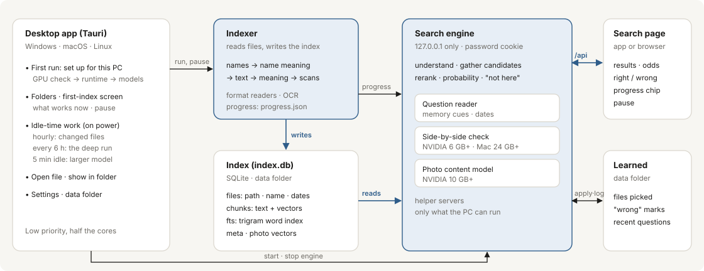
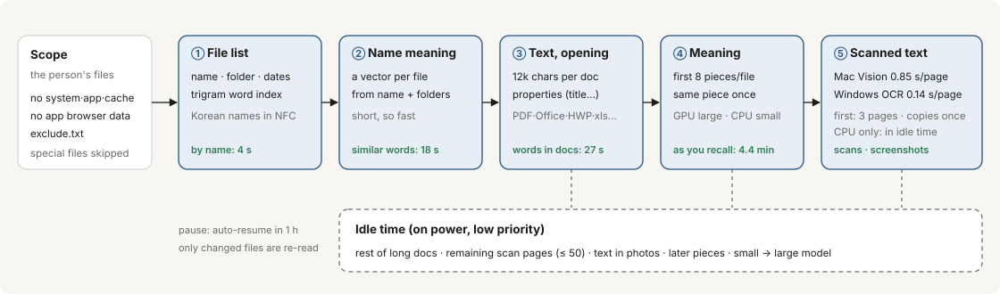
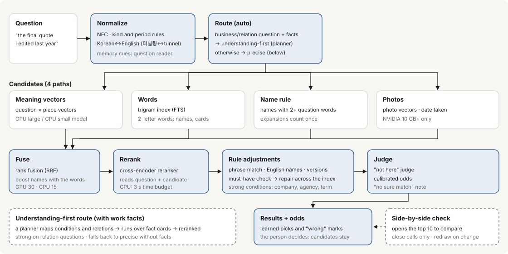

# findr

Find files on your PC the way you remember them. Ask "the quote that supplier sent last month" or "the draft right before the final one", and findr lists the likely files with the odds that each one is it. Everything runs on your own computer: no account, no upload, no cloud.

[Download](https://github.com/quantumaikr/findr/releases/latest) · [한국어](README.ko.md) · [How it works](#how-it-works) · [Performance](#performance) · [Lessons from the field](docs/LESSONS.md)

```
> beach photos from last summer's vacation
  1  92%  IMG_5082.jpg      2025-08-12
  2  71%  IMG_5090.jpg      2025-08-13
  3  38%  KakaoTalk_...jpg  2025-08-20

> 2019 tax refund receipt
  no sure match: the closest candidates below, with their odds
```

findr is built Korean-first, for the files Korean offices actually keep (HWP, scanned forms, Korean-named folders on a Mac), and it reads English names and text as well. It is an early project: version 0.2, released as installers for Windows, macOS and Linux.

## Why findr

People rarely remember file names. They remember what happened around a file: who sent it, roughly when, what it was for, which version it was. Desktop search tools match names and words, so they fail exactly when memory is vague. Cloud assistants can answer vague questions, but only after your files leave your PC.

findr sits between the two. It understands vague, conversational questions, and it does all of its work on the PC that holds the files.

## What makes it different

**Useful in seconds, smarter over time.** The first index is built for speed, and the rest is filled in while the PC is idle. On a 4-core laptop without a GPU, files are searchable by name after 4 seconds and by meaning of their names after 18 seconds. Words inside documents follow at 27 seconds, and full meaning search at 4.4 minutes. On a real PC, accuracy right after this first pass was within the run-to-run noise of accuracy after everything had been read.

**Asks the way people talk.** Time ("last August", "before the meeting"), people ("the one Mr. Kim sent"), versions ("the draft right before the final"), and Korean words for English file names (터널링 finds `Tunneling_Design.pdf`) are read together with the content of the question. A format or a kind of document named in the question ("the pdf", "the minutes") is kept as a condition to the end. Years as people say them (작년 "last year", 올해 "this year") are read as periods, and when nothing fits that year, the years next to it are searched and findr says so. Copies of the same file take one place in the list.

**Reads what is really on office PCs.** It reads PDF, Word, Excel, PowerPoint and HWP/HWPX, including HWP distribution documents (decrypted following Hancom's published specification). It also reads legacy .xls and .ods, RTF in Korean code pages, e-mail (.eml), Keynote, Pages and Numbers, and iPhone HEIC photos. Text in scans and screenshots is read with the operating system's own recognizer where there is one: 0.14 s per page on Windows, 0.85 s on macOS.

**Honest about uncertainty.** Every candidate shows its odds. When nothing matches all of a question, findr says so instead of presenting the closest file as the answer. The person makes the final call, and findr learns from what they pick and what they mark as wrong.

**Private by construction.** Indexing and search run on the PC. The search page listens only on 127.0.0.1 and is protected by a password. Values that look like passwords or keys are masked, never indexed.

**Runs on the PC you have.** It adapts to NVIDIA GPUs, Apple silicon and CPU-only laptops. A PC without a GPU starts with a small model and moves to the larger one bit by bit while nobody is using it.

## Performance

All numbers are measured on questions that were not used to tune findr. They depend on the PC and its files; we report how each was measured.

**Accuracy**

| Set | Questions | Top-1 | Top-3 |
|---|---|---|---|
| 6 synthetic PCs never seen in development, no activity history | 288 | 76% | 90% |
| A real personal PC, held-out questions | 45 | 84% | 89% |
| Same PC indexed from scratch: right after the fast first pass | 45 | 82% | 87% |
| Same PC indexed from scratch: after the idle-time deep run | 45 | 82% | 89% |
| Photos mixed with documents, photo questions (NVIDIA GPU) | 47 | 85% | — |
| The real PC on 4 CPU cores without a GPU, first day | 45 | 56% | 62% |
| The real PC on 4 CPU cores without a GPU, after the idle-time model upgrade | 45 | 78% | 82% |

**Lower on new questions.** The real-PC questions above have been in use for a long time. On 30 new questions about real files (written before any search, scored once), the top result was right 33% of the time and in the top 3 53% of the time. Most misses came from picking the wrong one of several versions of a document.

**Speed of the first index** (4-core laptop, no GPU, 2,081 files)

| Searchable by | Time |
|---|---|
| file name | 4 s |
| meaning of file names | 18 s |
| words inside documents | 27 s |
| meaning of contents | 4.4 min |
| full first index (scans left for idle time) | 4.4 min, down from 7 min in 0.2.8 |

When no file has changed, a new index run ends in 3.1 s (39.9 s in 0.2.15).

On a GPU PC, a real home folder of 4,780 files took 263 seconds for the whole first pass, text recognition included. On native Windows 11 with an NVIDIA GPU and Defender scanning, a real documents folder of 1,540 files was searchable by name after about 1 s and done in 55 s, including 47 scanned PDFs read by the built-in Windows recognizer in 16 s.

**Text recognition, per page** (Korean and English pages with known text)

| Engine | Characters right | Time |
|---|---|---|
| Windows built-in OCR (Korean) | 97.5% | 0.14 s |
| macOS Vision | 99.8% | 0.85 s |
| EasyOCR on 4 CPU cores, page scaled to 1600 px | 96% | 4.1 s |

**Answer time.** Windows and Linux give the same answers on the same index (checked on one PC, 120 questions); native Windows answers in 0.25 s (median) on an NVIDIA GPU and 2.5 s on 4 CPU cores. On an NVIDIA GPU, the real PC above answers in 0.2 s for half the questions and within 0.4 s for nine in ten (clean install). On 4 CPU cores without a GPU, the same real PC answers in 2.2 s for half the questions and within about 4 s for nine in ten. Each question has a fixed time budget for the reranker, so a hard question does not run on. Without a GPU, questions are read by rules: the small reading model took 3 s per question on 4 cores, slower than it helps.

On an Apple M1 Pro, half the questions are answered within 1.8 s (2.4 s in 0.2.15). A repeated question is answered at once, and recomputed if the index has changed. On Macs and PCs without a GPU, the first-stage list is shown at once and replaced in place by the reranked order.

**Large indexes.** A Mac home folder of about 57,000 files (5.7 GB index) used to stall for about 25 s once a minute. After the fixes in 0.2.10, no search out of 48 took longer than 8 s.

## How it works

Three parts work together on the PC. The indexer reads files and writes the index. The search engine reads the index and answers questions. The app starts and stops both and runs the work that waits for idle time.



**Indexing: fast first, smarter over time.** Each finished stage widens what can be found, and heavy work waits until the PC is idle.



**Search: from a question to results.** Candidates are gathered along several paths. A reranker then reads the question with each candidate to reorder them, and rules and a judge finish the list.



## Installation

### Desktop app (recommended)

Download the file for your system from the [releases page](https://github.com/quantumaikr/findr/releases/latest).

| System | File |
|---|---|
| Windows 10, 11 | `findr_<version>_x64-setup.exe` |
| macOS (Apple silicon) | `findr_<version>_aarch64.dmg` |
| Ubuntu, Debian | `findr_<version>_amd64.deb` (`sudo apt install ./<file>.deb`) |
| Fedora and similar | `findr-<version>-1.x86_64.rpm` |
| Other Linux | `findr_<version>_amd64.AppImage` (make it executable, then run) |

On the first run the app sets up what suits the PC: 5–20 minutes and 2–18 GB depending on the hardware (a 16 GB NVIDIA GPU PC with photo search: 5 minutes and 17.6 GB, measured on Windows 11). It then asks which folders to index, and moves to the search screen as soon as file names are in.

The installers are not code-signed yet, so the first launch may show a warning:

- Windows: on "Windows protected your PC", choose "More info", then "Run anyway".
- macOS: right-click the app and choose "Open". If macOS says the app "is damaged", move it to Applications and run `xattr -cr /Applications/findr.app` once in Terminal.
- Linux AppImage: `chmod +x findr_*.AppImage`, then run it. Ubuntu 22.04 or later.

### Command line

You need git and about 10 GB of free disk space. The installer sets up its own Python. The internet is used only to download models on the first run.

```powershell
# Windows (PowerShell)
git clone https://github.com/quantumaikr/findr
cd findr
powershell -ExecutionPolicy Bypass -File install.ps1
```

```bash
# macOS, Linux
git clone https://github.com/quantumaikr/findr && cd findr
bash install.sh
```

To update, run `git pull` and then the install script again. `findr doctor` lists anything that is missing and prints the one-line fix.

## Usage

Run `.\findr` on Windows or `./findr.sh` on macOS and Linux, from the repository folder.

```
findr index                          index your own files across the PC (later runs pick up changes only)
findr index D:\docs E:\photos        index only these folders
findr serve                          open the search page (http://127.0.0.1:8096)
findr ask "report I edited last week"   search from the terminal
findr setup                          re-download models or change the setup (--lite, --photo)
findr doctor                         check the installation and the index
```

You can search while indexing runs. The search page shows a small progress chip that opens a live view of every stage, with a pause button. To leave a folder out of a whole-PC index, list it in `exclude.txt` in the data folder.

## Use findr from AI tools

AI assistants on your PC can find your files through findr. Ask "find last month's quote from the supplier and summarize it", and the assistant searches with findr and reads the file it found. findr speaks MCP, the standard way assistants connect to local tools.

Four tools are offered, so that an assistant can look around the way a person does.
- `search_files` returns the likely files with their odds, location, date and a short excerpt. It can be narrowed to a format (pdf, hwp, slides...), a kind of document, a period or a folder.
- `list_folder` lists the files of one indexed folder.
- `versions` lists the other versions of a file, including similar files that may be a version under another name.
- `read_file` returns the text findr already read from a file in its index; it never opens other paths.

There are 14 kinds of document, such as minutes, contracts, quotes, reports, official letters, regulations and lecture material. The kind is read from what the index already holds, with no extra reading. Measured on real documents it is right about 65% of the time, so only files that are surely of another kind are left out; the rest stay in the list, marked as uncertain.

```bash
# Claude Code
claude mcp add findr -- <python> -m findr mcp
```

```json
// Claude Desktop: Settings → Developer → Edit config
{ "mcpServers": { "findr": { "command": "<python>", "args": ["-m", "findr", "mcp"] } } }
```

`<python>` is findr's own Python. The desktop app shows both lines, ready to copy, under Settings → AI tools. For a command-line install, it is `.venv/bin/python` (Windows: `.venv\Scripts\python.exe`) in the repository folder.

What the tools return goes to the assistant that asked. If the assistant runs in the cloud, file names and excerpts can leave the PC there, so set the assistant to ask before it uses a tool.

## Differences by hardware

| | NVIDIA GPU | Apple silicon Mac | No GPU |
|---|---|---|---|
| Meaning search | large model | small model first; the large one after its download, only if it measures fast enough | small model first, large model in idle time |
| Text in scans | GPU recognizer | macOS Vision | Windows OCR if installed, otherwise in idle time |
| Second-pass comparison | 6 GB+ GPU memory | 24 GB+ memory, close calls only | off |
| Reading the question | small language model | small language model | rules |
| Photo content search | 10 GB+ GPU memory | name and date | name and date |

## Data and privacy

File contents, questions and search history never leave the PC. Everything findr creates is kept in one folder, `%LOCALAPPDATA%\findr` on Windows and `~/.findr` on macOS and Linux; deleting it removes all of it. Searched files are only read, never modified. Passwords, certificates and key files are not indexed. On a shared PC only the signed-in user's folders are indexed.

## Known limitations

- On new questions about real files, the top result is right about one time in three (top-3: about half). Picking the right one of several versions of a document is the weakest part.
- The kind of a document is wrong about one time in three, most often for official letters and forms, so most files are marked as uncertain.
- On a laptop without a GPU, the first day is less accurate (56% top-1 on the real PC, against 84% on a GPU). It reaches 78% once the larger meaning model has been built in idle time.
- History such as who sent a file or when it was printed can only be used if the PC keeps such records. Without them findr searches by content and says the history could not be checked.
- Scanned images whose names do not look like documents are read only in idle time on CPU-only PCs, so right after the first index they are found by name.
- Broad photo requests ("donut photo") over thousands of photos match many pictures; adding a time ("last spring") narrows them a lot.
- The installers are not code-signed yet.

## Lessons from the field

Most of what changed in 0.2.x came from people installing findr on their own machines and reporting what broke: 20 issues and 18 pull requests in the first two days. Some examples:

- Korean names on macOS are stored decomposed (NFD). Name search missed most Korean-named files until everything was compared in NFC.
- On a 57,000-file Mac, a once-a-minute count over the whole index stalled search for 25 s. This was invisible on smaller test PCs.
- macOS's own text recognition was 37 times faster than the library we shipped, and more accurate on Korean.
- New file readers did nothing for PCs that were already indexed until the indexer learned to re-read files it had stored as empty.

[docs/LESSONS.md](docs/LESSONS.md) collects these as sixteen rules, and the pull request template turns them into a short checklist.

## Roadmap

- Accuracy on a PC findr is new to: picking the right version of a document first.
- "How many files did you open before you found it" as the main measure: less checking, not only a better top-1.
- Closing the accuracy gap on laptops without a GPU, above all on the first day.
- Reading the files people look for first: building on the kind of document (0.2.16) to read the likely files in depth first.
- Learning more from use: the files people open and pick should shape both ranking and what gets read first.
- Code-signed installers for Windows and macOS.
- More languages beyond Korean and English.
- Deeper links with AI tools: let assistants act on what findr finds, with the person's approval.

## Taking part in a usability test

We are testing findr with office workers on Windows and macOS PCs, with and without a GPU. If you are taking part, follow the [tester guide](docs/TESTER_GUIDE.md) (in Korean). It covers installing version 0.2.11 or later, the first index, ten questions about your own files, what to record, and how to send a report without exposing file names. The developer-side procedure is in [docs/FIELD_TESTING.md](docs/FIELD_TESTING.md).

## Contributing

Bug reports and pull requests are welcome. Measurements from real machines are the most useful thing you can send: the hardware, the number of files, and the time or result before and after.

- Do not put real file, company or person names in issues, commits, code or tests. Describe them generically.
- Every pull request runs the tests on Windows, macOS and Linux. Changes to ranking should compare top-1 results on a question set before and after.
- Read [docs/LESSONS.md](docs/LESSONS.md) before a larger change; the PR template lists the checks.

## License

Apache License 2.0. Models downloaded during setup follow their publishers' licenses.

본 제품은 한글과컴퓨터의 한글 문서 파일(.hwp) 공개 문서를 참고하여 개발하였습니다. (HWP reading follows Hancom's published HWP file format documents.) Report security issues as described in [SECURITY.md](SECURITY.md). Changes are listed in [CHANGELOG.md](CHANGELOG.md).

## Who runs findr

findr is an open-source project run together by (주)퀀텀아이 ([quantumai.kr](https://quantumai.kr)), (사)한국인공지능연구소 ([ai-lab.kr](https://ai-lab.kr)) and H3Lab ([h3lab.kr](https://h3lab.kr)).
